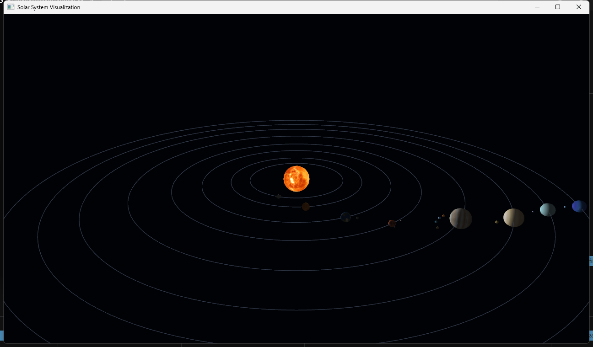

# Solar System Visualization

[](https://github.com/ShOOmet14/Solar-System/actions/workflows/build.yml)

An interactive 3D Solar System visualization written in C++ with OpenGL 3.3.
The project focuses on object-oriented C++, real-time rendering, transformations,
textures, lighting, and camera interaction.

> This is an educational graphics visualization, not an astrophysical simulator.
> Planet sizes, orbital distances, and animation speeds are deliberately chosen
> for visibility and are not to physical scale.



## Overview

The application renders the Sun, eight planets, and selected moons as textured
or colored spheres. Planets follow simplified circular paths around the Sun,
while moons are updated relative to their parent planet. A free camera can move
through the scene using keyboard and mouse input.

The project originated as an object-oriented programming assignment and has
been cleaned up as a compact graphics portfolio project. It intentionally keeps
the rendering architecture small rather than introducing a general-purpose
engine or physically based orbital model.

## Features

- Textured Sun and planets
- Selected parent-relative moons
- Frame-time-based circular orbit animation
- Planet and moon self-rotation
- Visible orbital paths
- Basic ambient, diffuse, and emissive lighting
- Perspective projection with a resizable window
- Free camera movement, mouse look, and scroll zoom
- Explicit OpenGL resource cleanup
- Shader compilation, program linking, window, and texture error reporting

## Technical Approach

`Planet` stores the visual radius, fallback color, texture, rotation state, orbit
parameters, and child moons for a celestial body. Its recursive `update()` method
is the single animation path: each body advances its own rotation and orbit, then
updates its moons relative to its current position.

The renderer creates one indexed sphere mesh shared by all bodies and one unit
circle mesh shared by all orbit paths. Model, view, and projection matrices are
calculated with GLM and passed to GLSL vertex and fragment shaders. Textures are
loaded through `stb_image`; bodies without an appropriate texture use stable
neutral colors instead of random substitute images.

Animation uses frame time, so its speed does not depend on the rendering frame
rate. Large frame steps are capped to avoid a visible jump after the application
has been paused or minimized.

## Controls

| Input | Action |
| --- | --- |
| `W`, `A`, `S`, `D` | Move the camera forward, left, backward, and right |
| Hold `Left Shift` | Move faster |
| Mouse movement | Look around |
| Mouse wheel | Adjust the field of view |
| `Esc` | Close the application |

The mouse cursor is captured while the application window is active.

## Build and Run

The verified workflow targets 64-bit Windows with Visual Studio 2022. Install:

- Visual Studio 2022 with **Desktop development with C++**
- Git
- CMake 3.24 or newer

Configure and build from the repository root:

```powershell
cmake -S . -B build -G "Visual Studio 17 2022" -A x64
cmake --build build --config Release --parallel
```

Run the executable:

```powershell
.\build\Release\SolarSystem.exe
```

CMake downloads the pinned GLFW 3.4 and GLM 1.0.1 sources while configuring.
The generated OpenGL 3.3 GLAD loader and `stb_image` 2.30 are stored in the
repository. Runtime textures are copied beside the executable automatically.

Visual Studio 2022 can also open the repository folder directly as a CMake
project. The previous hand-written solution was removed because it contained
absolute, machine-specific dependency paths and could not build from a clean
checkout.

## Project Structure

```text
.
├── .github/workflows/build.yml     Clean Windows build verification
├── docs/solar-system.png           Representative application screenshot
├── Solar System/
│   ├── application.cpp             Window, shaders, meshes, camera, render loop
│   ├── Planet.h and planet.cpp     Body animation, drawing, texture loading
│   ├── planets_setup.cpp/.h        Visual planet and moon configuration
│   ├── resources/                  Runtime planet textures
│   └── stb_image.cpp/.h            Image loading dependency
├── third_party/glad/               Generated OpenGL 3.3 loader
├── CMakeLists.txt
└── THIRD_PARTY_NOTICES.md
```

## Verification

The project is compiled from a clean CMake configuration in the GitHub Actions
Windows build. Rendering behavior is verified manually because an OpenGL window,
GPU driver, camera input, and visual output are not meaningfully covered by
artificial unit tests.

The manual verification checklist covers window creation, texture loading,
lighting, orbit visibility, parent-relative moons, self-rotation, camera movement,
mouse look, zoom, resizing, and clean application shutdown.

## Limitations

- Planet sizes and orbital distances are not to physical scale.
- Angular speeds are simplified visual values rather than ephemeris data.
- All paths are circular and use a common, simplified orbital plane.
- Axial tilts, orbital inclination, eccentricity, rings, and collisions are not modeled.
- Gravitational interaction and N-body dynamics are not simulated.
- The application is not an astronomical ephemeris or scientific prediction tool.
- Several moon surfaces use neutral colors because verified texture assets are unavailable.
- The original repository did not document the provenance or redistribution terms
  of the planet texture images. Their licensing should be established before reuse
  outside this educational project.

## Technologies

- C++17
- OpenGL 3.3
- GLFW 3.4
- GLAD
- GLM 1.0.1
- stb_image 2.30
- CMake

## Future Development

Realistic next steps include better asset provenance, improved lighting, optional
orbital inclination, configurable animation speed, Saturn ring geometry, and a
small in-application help overlay. High-accuracy orbital mechanics is deliberately
outside this project's scope.
